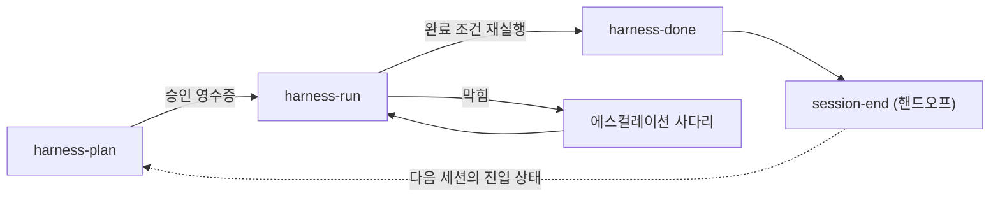

<a id="top"></a>

<div align="center">

<picture>
  <source media="(prefers-color-scheme: dark)" srcset="assets/knot-mark-dark.svg">
  
</picture>

# askewly-harness

### Claude Code와 Codex를 함께 운용하기 위한 개인 에이전트 운영 체계, 플러그인.

<h2>"완료"는 누군가 다시 돌려보기 전까지 주장입니다.</h2>

<p>작업 권한, 승인 경계, 완료의 증거.</p>

<p>
  
  
  
</p>

<p>
  <a href="#install">설치</a> ·
  <a href="#quickstart">시작하기</a> ·
  <a href="#what-this-defines">시스템</a> ·
  <a href="#failure-model">실패 모델</a> ·
  <a href="#operating-lifecycle">생명주기</a> ·
  <a href="#from-intent-to-standard">의도</a> ·
  <a href="#execution-boundary">실행</a> ·
  <a href="#evidence-backed-completion">검증</a> ·
  <a href="#delegation">위임</a> ·
  <a href="#persistent-context">맥락</a> ·
  <a href="#whats-in-the-box">패키지</a> ·
  <a href="./README.md">English</a>
</p>

</div>

이 저장소는 한 사람이 두 개의 코딩 에이전트를 운용하는 하네스의 플러그인 배포판입니다. 아래 산문이 체계를 서술하고, `skills/` 에는 그 체계를 구현하는 스킬이 들어 있습니다. 비공개 원본에서 특정 커밋 기준으로 떠 와 공개용으로 디커플링한 것입니다. (이 문서의 읽기 전용 판은 *luka-playbook* 이라는 이름으로 먼저 공개되었고, 지금은 여기로 통합되었습니다.)

<a id="install"></a>

## 설치

**Claude Code**

```text
/plugin marketplace add lumatic2/askewly-harness
/plugin install askewly@askewly
```

업데이트(끝나면 Claude Code 를 다시 시작합니다):

```text
/plugin marketplace update askewly
/plugin update askewly@askewly
```

새 판은 판 번호가 바뀌었을 때만 내려옵니다.

**Codex**

```text
codex plugin marketplace add lumatic2/askewly-harness
codex plugin add askewly@askewly
```

업데이트: `codex plugin marketplace upgrade askewly`

스킬 다섯 개가 설치됩니다: `harness-plan` · `harness-run` · `harness-done` · `harness-bootstrap` · `session-end`. 부를 때는 `/askewly:harness-plan` 처럼 플러그인 이름을 앞에 붙입니다(Codex 는 `$askewly:harness-plan`). Claude Code 에서는 같은 이름의 다른 스킬이 없으면 `/harness-plan` 으로도 불립니다. 판별 변경 내용은 [CHANGELOG.md](./CHANGELOG.md) 에 있습니다.

빈 폴더에서 부트스트랩 → 계획 → 실행 → 완료까지 실제로 돌려 본 환경은 Windows 11 의 Claude Code·Codex 와 macOS 의 Codex 입니다. macOS 의 Claude Code 는 설치까지만 확인했고, 전체 구동은 아직 돌려 보지 않았습니다.

| 환경변수 | 기본값 | 용도 |
|---|---|---|
| `HARNESS_JOURNAL_DIR` | `~/harness-journal` | `session-end` 가 일지를 덧붙이는 위치 |
| `AO_ROOT` | (미설정) | 선택: 번들 대신 외부 체크아웃의 부트스트랩 엔진을 사용 |

<a id="quickstart"></a>

## 시작하기

```text
/askewly:harness-bootstrap   # 레포당 1회: CLAUDE.md·ROADMAP.md·docs/adr·changesets 를 깝니다
/askewly:harness-plan        # 결정을 소진하고 step 으로 분해해 승인 1회를 받습니다
/askewly:harness-run         # 승인된 계획을 되묻지 않고 실행합니다
/askewly:harness-done        # 완료 조건을 재실행해 판정하고 보고서와 상태를 남깁니다
/askewly:session-end         # 세션 마감: 핸드오프 파일 + 일지 append
```

`harness-bootstrap` 은 빈 구조만 깝니다. 작업 규칙은 세 스킬 본문에 삽니다. non-trivial 작업은 `/askewly:harness-plan` 으로 시작하고, 승인 1회로 끝나며, `/askewly:harness-run` 이 승인된 계획 전체를 재확인 없이 실행합니다.

<a id="what-this-defines"></a>

## 이 체계가 정의하는 것

계획 스킬과 검증 스킬과 메모리 도구를 한데 묶은 모음이 아닙니다. 이 이름들은 개별 기능을 설명할 수는 있지만, 그 기능들이 함께 구현하는 체계까지 설명하지는 못합니다.

이 체계는 한 사람이 두 개의 코딩 에이전트를 상시로 운용하기 위한 운영 환경입니다. 에이전트가 어디까지 스스로 판단해도 되는지, 서로 다른 근거가 충돌할 때 무엇을 기준으로 삼는지, 무엇이 완료의 증거인지, 어떤 지식이 세션 이후에도 남아야 하는지를 정합니다.

여기 있는 규칙은 모델보다 잘 생각하려 들지 않습니다. 에이전트가 어디서 멈추고 물어야 하는지, 산출물이 상태로 승격되기 전에 무엇을 보여야 하는지, 지금 이 작업을 두 에이전트 중 누가 쥐고 있는지를 적을 뿐입니다. 그 사이는 전부 모델의 판단입니다.

| 권위의 출처 | 정하는 것 | 정하지 않는 것 |
|---|---|---|
| 사용자 | 방향, 선호, trade-off, 승인 | 구현 세부 방식 |
| 북극성 | 저장소가 향하는 지점. 사용자가 소유하는 한 문장입니다 | 현재 작업이 무엇인지 |
| 계획서 | 작업 단위, 완료 조건, 위험 등급 | 실행 순서의 세부 |
| 승인 영수증 | 실행해도 되는지 | 무엇을 실행하는지 |
| 코드 | 현재 구현 사실과 저장소 관례 | 앞으로 원하는 동작 |
| 증거 | 실행이 실제로 완료되었는지 | 무엇을 만들었어야 하는지 |
| 저장소 지시문 | 저장소 전체에 지속되는 제약 | 현재 작업의 의도 |

두 출처가 충돌할 때 어느 쪽도 상대를 자동으로 덮지 않습니다. 충돌 자체를 사용자에게 올리고, 승인을 받은 뒤 양쪽을 함께 갱신해 다시 일치시킵니다.

세 진입점이 이 운영 모델을 구성하며, 모두 사용자가 명시적으로 호출합니다.

| 진입점 | 역할 | 결과 |
|---|---|---|
| `harness-plan` | 작업이 암시하는 결정을 미리 확정하고 실행 기준을 세웁니다 | 승인된 계획서와 영수증 |
| `harness-run` | 승인된 계획을 실행하되 요구 동작을 다시 정의하지 않습니다. 기준이 충돌하면 사용자에게 돌아옵니다 | 검증된 변경 |
| `harness-done` | 완료 조건을 다시 실행해 판정하고 다음 작업으로 넘길 상태를 남깁니다 | 완료 보고서와 갱신된 저장소 상태 |

<a id="failure-model"></a>

## 구조적 실패 모델

현재의 코딩 모델은 이미 상당한 규모의 구현을 수행합니다. 반복되는 문제는 모델의 능력보다 그 능력을 둘러싼 작업 구조에서 나옵니다.

세션은 대체로 불완전한 입력에서 시작합니다. 모델은 학습된 패턴과 눈앞의 코드로 빈칸을 채우고, 그 해석을 구현한 뒤, 같은 관점에서 결과를 평가합니다. 해석이 틀렸다면 수정 비용은 코드가 생긴 뒤에 발생하고, 구현이 수용되었다면 다음 세션에는 결과만 남고 이유는 사라집니다.

여러 압력이 서로를 강화합니다.

| 실패 압력 | 결과 |
|---|---|
| 미확정 의도 | 그럴듯한 기본값이 사용자가 원하지 않은 결정으로 굳습니다 |
| 권위 혼선 | 코드와 계획과 모델의 선호가 사용자의 요구를 덮습니다 |
| 자기 검증 | 같은 해석이 결과를 만들고 그 결과를 옳다고 판정합니다 |
| 성공 응답의 오독 | 도구가 반환한 성공을 의도한 일이 일어난 증거로 씁니다 |
| 서술로 대체된 증거 | 재실행할 수 없는 설명이 완료의 근거가 됩니다 |
| 사본 확산 | 같은 사실이 여러 곳에 적히고 갈라진 시점을 아무도 모릅니다 |
| 상시 맥락의 선형 증가 | 매 세션 주입되는 설명이 늘어 판단 대상이 흐려집니다 |
| 균일한 의식 | 작은 작업에 과한 비용을 쓰고 위험한 작업에 검증이 모자랍니다 |

이들을 개별 문제로 다루지 않습니다. 의도 확정과 계획과 실행과 검증과 지속되는 맥락이 모두 같은 권위 모델 위에서 동작합니다.

## 경계 있는 자율

에이전트는 명시된 권한 안에서 폭넓게 판단하되, 그 경계 자체를 조용히 넓히지 못합니다.

설계를 가두는 실패 방향이 둘입니다. 내버려 두면 에이전트는 열려 있는 질문을 가장 익숙한 답으로 메우고, 그 답이 아무도 합의하지 않은 요구사항이 됩니다. 반대로 과하게 규정하면 작업이 아니라 규정을 만족시키기 시작하고, 체크리스트 자체가 최적화 대상이 됩니다.

그래서 제약을 절차가 아니라 최소선으로 적습니다. 의도에는 근거가 붙고, 동작에는 정본이 하나 있고, 완료에는 증거가 따르고, 다시 얻기 어려운 지식은 실행 이후에도 남습니다. 그 최소선 위로는 규정하지 않습니다.

의식의 크기는 작업에 맞춥니다. 위험 등급이 검증의 두께를 정합니다.

| 등급 | 판정 기준 | 요구되는 검증 |
|---|---|---|
| 위험 | 지금까지 통과하던 것이 막히기 시작합니다 | 프로브와 독립 검증, 오탐이 없음을 실측 |
| 기계적 | 막히는 집합이 그대로입니다 | 프로브 한 건과 회귀 테스트 |
| 없음 | 산출물이 기록뿐입니다 | 기록 정합과 수치 출처 확인 |
| 미분류 | 판단이 서지 않습니다 | 위험과 동일하게 취급합니다 |

먼저 산출물이 기록뿐인지 봅니다. 아니라면 그때 막히기 시작하는지로 위험과 기계적을 가릅니다. 등급은 의식의 크기만 정하며 검증의 면제를 뜻하지 않습니다. 빈칸은 안전의 표시가 아닙니다. 생산자가 판단하지 않았다는 사실을 안전하다는 뜻으로 읽지 않습니다.

<a id="operating-lifecycle"></a>

## 작업 생명주기



`plan`과 `run`은 하나의 연속된 사이클입니다. 대화에 남은 맥락은 판단을 도울 수 있지만 승인된 계획을 대신하지 못합니다. 두 단계 사이의 실제 기준은 대화가 아니라 영수증입니다.

세션은 핸드오프로 닫습니다. 핸드오프는 세션 요약이 아니라 다음 세션이 이어받을 상태만 기록합니다. 이어서 할 일, 현재 계획상의 위치, 지금 알아야 할 함정이 여기에 들어갑니다. 저장소가 추적하는 파일로 두어 다른 기기에서도 이어받을 수 있게 합니다.

세션의 종료와 작업의 완료는 다른 사건입니다. 오늘 여기까지라는 판단이 작업 단위를 완료로 바꾸지 않습니다.

<a id="from-intent-to-standard"></a>

## 의도에서 실행 기준까지

`harness-plan`은 입력을 실행의 기준으로 바꿉니다. 계획을 보기 좋게 정리하는 단계가 아니며, 문서가 자세하다는 이유로 그 내용을 옳다고 가정하지도 않습니다.

모든 입력은 확정된 사실이 아니라 검토할 재료로 들어옵니다. 한 줄짜리 요청, 이전 세션의 기록, 모델이 만든 초안에는 사실과 선호와 제안된 해법이 섞여 있습니다. 계획서를 쓰기 전에 이를 분리합니다. 문장을 다듬는 과정에서 근거 없는 주장이 사실로 승격되는 일을 막기 위해서입니다.

핵심은 이번 변경에서 실제로 결정해야 하는 범위를 찾는 일입니다. 결정은 근거를 가진 주체에 따라 다르게 처리합니다.

| 결정의 종류 | 처리 방식 |
|---|---|
| 이미 밝혀진 목표와 제약에서 도출되는 결정 | 다시 묻지 않고 도출하며 이유를 보존합니다 |
| 아직 열려 있는 방향과 정책 결정 | 답에 따라 결과가 달라지는 지점을 짚어 사용자에게 묻습니다 |
| trade-off가 큰 기술 결정 | 구체적인 선택지와 추천안을 함께 제시합니다 |
| 결과를 바꾸지 않는 구현 튜닝 | 실행 단계의 판단에 맡깁니다 |

질문의 개수는 품질 지표가 아닙니다. 먼저 확정된 목표와 코드 사실에서 답을 도출하고, 그래도 남으며 잘못 고르면 결과가 달라지는 결정만 묻습니다.

계획서가 서기 전에 대화를 보지 않은 검증자가 한 번 읽습니다. 미확정 결정과 근거 없는 추측을 찾는 것이 그 역할입니다. 이 검증은 자문이며 사용자의 승인을 대신하지 않습니다.

`plan` 구간은 문서만 씁니다. 구현 코드를 커밋하지 않습니다.

## 승인 영수증

승인은 대화에 남는 동의가 아니라 등록되는 상태입니다. 계획서의 해시를 영수증으로 기록하고, `harness-run`은 그 영수증 위에서만 돌아갑니다.

계획서는 승인 직후 단독 커밋으로 남깁니다. 영수증 자체는 저장소가 추적하지 않으므로, 이 작업이 언제 승인되었는지 확인할 기준점이 이력에 필요하기 때문입니다.

| 산출물 | 책임 |
|---|---|
| 계획서 | 작업 단위, 각 단위의 완료 조건, 위험 등급, 산출물의 배치 |
| 영수증 | 승인의 존재와 대상의 동일성 |
| 계획서의 체크박스 | 진행 상태의 쓰기 정본. 단위가 끝날 때마다 표시합니다 |

계획과 실행이 충돌하면 계획이 우선합니다. 실행 중에 계획 자체가 잘못되었거나 불완전해 보인다면 편한 방향으로 고치지 않고 사용자에게 돌아갑니다.

<a id="execution-boundary"></a>

## 승인 경계 안의 실행

`harness-run`은 승인된 계획을 실행의 기준으로 씁니다. 구현 방법을 고르고 저장소를 조사하고 전략을 조정할 수는 있지만, 요구 동작을 구현하기 쉬운 해석으로 바꿀 수는 없습니다.

작업 단위마다 구현과 실제 표면 검증과 커밋이 한 묶음입니다. 단위가 끝났다는 사실이 턴의 종료를 뜻하지 않습니다. 이미 받은 승인의 의미를 유지하기 위해, 진행 여부를 매 단위마다 다시 묻지 않습니다.

막힘은 사다리로 처리합니다.

| 단계 | 처리 |
|---|---|
| 1 | 빠진 맥락을 채워 다시 시도합니다 |
| 2 | 모델을 올려 다시 배차합니다 |
| 3 | 수집한 증거와 함께 사용자에게 판단을 요청하고 대기합니다 |

사다리는 작업자가 아니라 오케스트레이터의 것입니다. 진행하지 못하는 작업자는 상태를 반환하고 멈추며, 올라가는 쪽은 오케스트레이터입니다.

재시도는 새로운 정보가 생길 때만 의미가 있습니다. 가설과 환경과 입력이 그대로인데 같은 실패를 반복하는 것은 진행이 아닙니다. 두 번이 상한이며, 오케스트레이터가 자기 재시도에서 맴도는 것을 막습니다.

되돌릴 수 없는 행위는 사다리 밖에 있습니다. 보호 규칙이 그냥 차단하며, 실행 중이라는 사실이 통과 사유가 되지 않습니다.

최종 통합 권한은 사용자에게 남습니다. 구현을 허용했다는 사실을 이력 재작성, 승인되지 않은 병합, 관련 없는 변경의 은폐까지 허용한 것으로 해석하지 않습니다.

<a id="evidence-backed-completion"></a>

## 증거 기반 완료 판정

완료는 자신감에 대한 주장이 아니라 증거에 대한 주장입니다.

`harness-done`은 계획서가 정한 완료 조건을 다시 실행해서 판정합니다. 충족한 것으로 보인다는 판단은 판정이 아닙니다. 완료 보고서는 두 가지를 요구합니다. 어느 표면에서 확인했는지, 그리고 다른 사람이 그대로 입력해 같은 결과를 볼 커맨드가 무엇인지입니다.

도구가 반환한 성공을 결과의 증거로 쓰지 않습니다. 명령이 성공을 반환하는 사건과 의도한 일이 일어나는 사건은 다릅니다. 성공 응답을 받아도 대상이 비어 있었거나 다른 대상에 적용되었을 수 있으므로, 변경의 유무는 별도 수단으로 판정합니다.

평가할 수 없었던 검사는 실패로 취급합니다. 검증 명령이 단언에 도달하기 전에 종료되었거나 외부 상태를 관찰할 수 없다면, 눈에 띄는 오류가 없다는 이유로 성공을 추론하지 않습니다.

검증의 관점을 분리합니다. 모든 검사에 같은 맥락을 통째로 주면 이해가 깊어지는 대신 기존 해석에 끌려갑니다. 한 관점은 계획이 확정된 의도를 담았는지 봅니다. 다른 관점은 대화를 보지 않고 계획만으로 실행할 수 있는지 판단합니다. 구현 검증은 작업자의 설명이 아니라 실제 변경과 요구 동작을 봅니다.

독립성은 모델을 바꾸는 것으로만 얻지 않습니다. 같은 모델이어도 대화를 보지 않은 새 세션이면 자기 평가의 천장을 부분적으로 넘습니다.

<a id="delegation"></a>

## 위임 규약

위임에는 건별 사용자 허락이 필요 없고, 네 가지만 사전 승인을 받습니다. 큰 규모의 병렬 실행, 워크플로, 원격 실행, 되돌릴 수 없는 외부 영향입니다. 이는 누구에게 물어야 하는가의 규칙이지 배차를 권하는 말이 아닙니다. 어떤 일을 실제로 배차할지는 아래 기준이 따로 정합니다.

권한의 배분은 고정되어 있습니다.

| | 오케스트레이터가 직접 | 위임 |
|---|---|---|
| 대상 | 설계 판단, 명세 작성, 게이트 판정, 통합, 사용자 전역 파일 | 명세가 고정된 구현, 조사, 대량 스캔, 기계적 작업 |
| 근거 | 틀리면 하류가 오염됩니다 | 되돌림이 저렴하고 정답 판정이 기계적입니다 |

등급과 배차는 다른 축입니다. 등급은 검증의 두께를 정하고 배차는 누가 수행할지를 정합니다. 둘을 한 축으로 묶으면 이득 없는 배차가 늘어납니다.

배차는 네 가지 중 하나는 사야 합니다. 파일 격리, 독립된 시각, 맥락 격리, 실제 소요 시간의 단축입니다. 하나도 사지 못하면 직접 수행합니다. 직접 수행하더라도 증거 의무와 검증의 두께는 그대로입니다. 배차를 줄이는 것이지 증명의 기준을 낮추는 것이 아닙니다.

무엇을 샀는지 기록합니다. 배차가 범위를 산 것인지 판단을 산 것인지 구분하지 않으면, 작업자의 1차 판정을 그대로 수용하게 되고 어디를 다시 확인해야 하는지도 알 수 없습니다.

모델은 작업의 이름이 아니라 되돌림 비용과 판단 밀도로 고릅니다. 실패해도 저렴하게 되돌릴 수 있고 정답 판정이 기계적이면 하위 모델을 쓰고, 틀리면 하류를 오염시키는 자리에는 상위 모델을 씁니다. 판단이 서지 않으면 하위로 걸고 결과를 직접 검증합니다. 모델을 지정하지 않으면 상위 모델을 조용히 상속하므로, 미지정 자체를 차단합니다.

위임의 깊이는 하나입니다. 위임받은 작업자는 다시 위임하지 않습니다.

## 작업자와 검증자의 계약

작업자에게는 네 가지를 줍니다. 목표와 대상과 요구되는 검증의 두께를 담은 작업 계약, 근거 문서의 경로, 어겨서는 안 되는 제약, 그리고 보고의 형식입니다. 근거는 경로로 줍니다. 본문을 프롬프트에 옮겨 적으면 사본이 생기고, 사본은 정본이 개정되어도 따라가지 않습니다.

작업자는 네 가지를 돌려줍니다.

| 필드 | 내용 |
|---|---|
| 상태 | 완료, 우려가 있는 완료, 맥락 부족, 막힘 중 하나입니다 |
| 변경 | 건드린 대상의 경로입니다 |
| 검증 | 실제로 실행한 커맨드와 종료 코드입니다. 통과했다는 서술은 미달입니다 |
| 우려 | 오케스트레이터가 저울질할 지점입니다. 인과 주장은 근거를 대거나 여기로 내립니다 |

실행이 없는 조사 작업에서는 읽은 입력의 경로와 개수가 검증 항목을 대신하며, 그 목록에 정본이 포함되어야 합니다. 요약본만 읽고 내린 결론은 요약이 낡은 만큼 틀립니다.

이 계약은 형식을 강제하지만 충분성까지 강제하지는 못합니다. 얇은 입력 하나만 읽고도 네 항목은 채워집니다. 그래서 배차를 수용할 때 표본 재실행이나 정본 대조로 다시 확인하는 일이 의무입니다.

검증자의 계약은 다릅니다. 판정 잣대를 프롬프트에 복제하지 않고 경로로 줍니다. 고정된 항목표도 주지 않습니다. 항목표를 주면 검증자는 그 표만 보고 끝내며, 잣대가 아니라 천장이 됩니다. 기준은 완료 조건과 저장소의 관례에서 도출하게 하고, 계약은 출력의 형식과 처분만 고정합니다.

검증자에게는 결론이 아니라 반증 과제를 줍니다. 기대하는 심각도를 미리 알려 주지 않으며, 검증자가 낸 지적을 보고에서 빼지 않습니다. 막지 않는 권고도 처분합니다. 각 항목을 수정했거나, 받아들이고 하지 않기로 했으며 그 이유가 무엇인지 기록합니다. 하지 않기로 한 것도 결정입니다.

## 비용 모델

비용을 토큰 하나의 문제가 아니라 전체 실행의 자원 배분 문제로 봅니다. 사용자의 주의, 상시 맥락, 출력, 에이전트 분리, 검증, 재시도, 전체 소요 시간을 함께 다룹니다.

가장 큰 낭비는 잘못된 방향으로 만든 뒤 되돌리는 작업입니다. 중요한 결정을 구현 전에 확정하는 비용은, 그럴듯한 가정을 구현하고 검토하고 고치고 다음 세션에 다시 설명하는 비용보다 작습니다.

| 비용이 생기는 지점 | 제어 방식 |
|---|---|
| 사용자의 주의 | 답에 따라 결과가 달라지는 미결정만 묻습니다 |
| 상시 맥락 | 매 세션 필요한 것만 상시로 올리고 나머지는 조건부로 내립니다 |
| 스킬 설명 | 설명은 라우팅에 쓰이므로 전량 주입됩니다. 사용법은 본문에 두고 설명은 짧게 유지합니다 |
| 에이전트 분리 | 격리, 독립성, 맥락 분리, 시간 단축 중 하나를 얻을 때만 사용합니다 |
| 재시도 | 새로운 증거가 나오지 않으면 멈추고 사용자 판단으로 올립니다 |

상시 맥락은 스킬을 늘릴수록 선형으로 자랍니다. 스킬을 추가하는 비용은 설명의 길이만이 아닙니다. 라우팅 후보가 늘어 어떤 스킬이 발동할지가 불확실해집니다. 그래서 스킬의 설명에는 담당 범위와 함께 담당하지 않는 범위를 적습니다.

같은 파일 형식을 쓰는 두 런타임이 같은 필드를 같은 방식으로 소비한다고 가정하지 않습니다. 한쪽이 이름으로 호출하고 다른 쪽이 설명으로 라우팅한다면, 설명을 일괄 압축하는 도구는 한쪽에서만 안전합니다.

비용 절감이 성공의 정의를 바꾸지 않습니다. 좁은 검사는 중간 단계를 빠르게 만들지만 통합 전체를 인증하지 못합니다.

<a id="persistent-context"></a>

## 지속되는 맥락

세션이 끝나도 남아야 하는 상태는 수명이 다릅니다.

| 상태 계층 | 수명 | 담는 것 |
|---|---|---|
| 계획서와 영수증 | 한 번의 작업 사이클 | 현재 작업의 기준 |
| 핸드오프 | 다음 세션 | 이어받을 지점과 지금의 함정 |
| 저장소 지시문 | 저장소 수명 | 지속되는 제약과 관례 |
| 지식 저장소 | 기기와 에이전트 무관 | 다시 얻기 어려운 지식 |

지시문은 두 겹입니다. 전역 지시문이 모든 저장소에 적용되고, 저장소 지시문이 해당 저장소에만 적용됩니다. 두 에이전트가 함께 지켜야 하는 규칙은 양쪽 진입 파일에 모두 적습니다. 문구는 달라도 내용은 일치해야 하며, 한쪽만 고치지 않습니다. 서로 다른 규칙으로 같은 저장소를 만지는 상태 자체가 사고이기 때문입니다.

규칙이 늘어나는 조건을 정해 둡니다. 사용자가 같은 교정을 반복하거나 항상 또는 다시는이라는 형태로 말하면, 그 자리에서 지시문에 추가할 것을 제안합니다.

에이전트 런타임의 자체 메모리는 정본이 아니라 지역적인 회수 수단입니다. 반복되는 결정은 공유 문서나 스킬 원본으로 올립니다. 메모리에 적힌 내용은 기록 시점의 사실이므로, 그 안의 경로와 이름이 아직 존재하는지 확인한 뒤에 사용합니다.

## 정본 규율

같은 사실을 두 곳에 적지 않습니다. 편의의 문제가 아니라, 갈라진 시점을 아무도 모르게 되기 때문입니다. 사람은 최신 문서를 알아서 고르지만 에이전트는 먼저 찾은 것을 읽고 그대로 실행합니다.

정본은 하나가 아니라 사실의 종류마다 다릅니다. 전체를 관장하는 저장소를 만들려 하지 않습니다. 어느 문서가 정본인지는 그 문서의 선언이 아니라 별도의 표가 정합니다. 자주 고친다는 사실이 최신이라는 뜻도 아닙니다.

기계가 대조할 수 있는 것과 없는 것을 나눕니다. 경로 목록과 등록 상태는 검사기가 판정합니다. 흐름과 단계처럼 자연어로만 표현되는 것은 문서의 의무로 둡니다. 개수는 정본 하나만 압니다. 참조하는 쪽이 개수를 함께 적으면 항목이 늘 때마다 어긋납니다.

## 두 에이전트의 관계

Claude와 Codex 사이에 고정된 계층을 두지 않습니다. 현재 작업을 쥐고 있는 쪽이 오케스트레이터이며, 양쪽 모두 계획과 편집과 검증과 커밋과 인계를 수행하고 같은 완료 계약을 집니다.

| 위치 | 적용 범위 |
|---|---|
| 저장소 문서 | 양쪽 모두 |
| 각 런타임 고유 기능 | 공유 문서로 승격하기 전에는 해당 에이전트만 |

같은 작업을 서로 다른 에이전트에게 동시에 맡기고 결과를 비교하는 방식은 별도의 승인 대상입니다. 정답 판정이 기계적이고 한 번의 실패 비용이 클 때만 사용합니다. 작업 공간의 격리는 파일 충돌만 막으며, 같은 추상화를 다른 방향으로 고치는 설계 충돌은 검토 단계에서만 드러납니다.

장시간 자율 실행 중인 세션에는 터미널 입력이 닿지 않습니다. 에이전트는 턴이 끝나야 대기 중인 입력을 읽기 때문입니다. 세션 사이의 연락은 상태로 지속되는 채널을 사용해 상대가 언제 확인하더라도 남아 있게 합니다.

<a id="whats-in-the-box"></a>

## 패키지 구성

```text
askewly-harness/
├── README.md · README.ko.md · LICENSE
├── CHANGELOG.md                 # 판마다 한 항목
├── .claude-plugin/              # Claude Code 플러그인·마켓플레이스 등록 파일
├── .codex-plugin/ · .agents/    # Codex 플러그인·마켓플레이스 등록 파일
├── sync.py · tests/             # 작성자용: 비공개 원본에서 재채취 + 디커플링 + leak-check
├── assets/
└── skills/
    ├── MANIFEST.md              # 파일별 sha256, 채취 커밋 고정 — sync.py 생성물
    ├── harness-plan/            # 계획: 결정 소진, 리프 루브릭, 계획서, 승인 게이트
    ├── harness-run/             # 실행: 승인 영수증, 무중단 규칙, 에스컬레이션 사다리
    │   └── scripts/             # 게이트 기계장치: approve/validate/report/ledger + 테스트
    ├── harness-done/            # 완료: 조건 재실행, 보고서, 로드맵 갱신
    ├── harness-bootstrap/       # 레포 부팅: 번들 init 엔진 + 템플릿
    └── session-end/             # 세션 마감: 핸드오프 커밋 + 일지 append
```

`skills/` 는 생성물입니다. `sync.py` 가 비공개 원본 저장소의 특정 커밋에서 파일을 떠 오고(커밋 안 된 원본은 거부), 개인 배선(기기명, 개인 경로, 개인 알림 채널)을 걷어내는 디커플링 규칙을 적용한 뒤, 잔류 검사가 0건이어야만 기록합니다. `skills/MANIFEST.md` 에 채취 커밋과 파일별 sha256 이 남습니다. 재채취에는 비공개 저장소가 필요하므로 `sync.py` 는 작성자 기기에서만 돌아갑니다. 여러분이 설치하는 것은 검사를 통과한 스냅샷입니다.

`skills/harness-run/scripts/` 를 읽으면 위 산문이 주장만 하는 것 대부분이 답해집니다. 승인 영수증이 실제로 무엇인지, 게이트가 무엇을 반려하는지, 테스트가 그것을 어디까지 붙잡는지.

## 적용 범위

혼자 일하는 한 사람을 전제로 설계했습니다. 사용자 승인이 자주 개입하고 병렬 실행의 이득이 작다는 가정이 곳곳에 반영되어 있어, 팀 규모에서는 맞지 않는 규약이 있습니다.

특정 스택이나 언어에 종속되지 않습니다. 산출물은 전부 일반 마크다운이며, 전용 도구 없이 읽고 수정할 수 있습니다.

## 라이선스

MIT

<div align="center"><sub>문서 형식은 <a href="https://github.com/fn-opt/dryforge">fn-opt/dryforge</a>를 참고했습니다. 설계서 전용 판이었던 luka-playbook 을 2026-08 에 이 설치형 판으로 통합했습니다.</sub></div>

<div align="center"><sub><a href="#top">맨 위로</a> · plan / run / done</sub></div>
