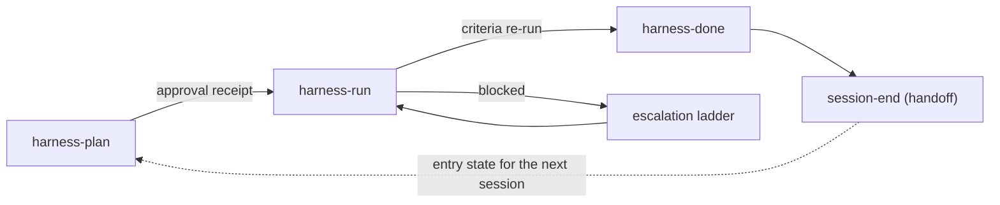

<a id="top"></a>

<div align="center">

<picture>
  <source media="(prefers-color-scheme: dark)" srcset="assets/knot-mark-dark.svg">
  
</picture>

# askewly-harness

### A personal operating system for running Claude Code and Codex together, as installable skills.

<h2>"Done" is a claim until something re-runs it.</h2>

<p>Authority boundaries, approval gates, and what counts as done.</p>

<p>
  
  
  
</p>

<p>
  <a href="#install">Install</a> ·
  <a href="#quickstart">Quickstart</a> ·
  <a href="#what-this-defines">System</a> ·
  <a href="#failure-model">Failure model</a> ·
  <a href="#operating-lifecycle">Lifecycle</a> ·
  <a href="#from-intent-to-standard">Intent</a> ·
  <a href="#execution-boundary">Execution</a> ·
  <a href="#evidence-backed-completion">Verification</a> ·
  <a href="#delegation">Delegation</a> ·
  <a href="#persistent-context">Context</a> ·
  <a href="#whats-in-the-box">Package</a> ·
  <a href="./README.ko.md">한국어</a>
</p>

</div>

This repository is the installable distribution of one person's harness for running two coding agents. The design prose below describes the system; `skills/` contains the skills that implement it, taken from the private originals at a pinned commit and decoupled for public use. (An earlier read-only edition of this document was published as *luka-playbook*, now merged here.)

<a id="install"></a>

## Install

```bash
bash install.sh           # installs into ~/.claude/skills/  (Claude Code)
bash install.sh --codex   # also installs into ~/.codex/skills/  (Codex)
```

On Windows PowerShell:

```powershell
./install.ps1             # ~\.claude\skills\
./install.ps1 -Codex      # also ~\.codex\skills\
```

Six skills are installed: `harness-plan`, `harness-run`, `harness-done`, `harness-bootstrap`, `session-end`, `session-log`. If a legacy `harness` skill from an older release is present, the installer removes it.

| Environment variable | Default | Purpose |
|---|---|---|
| `HARNESS_JOURNAL_DIR` | `~/harness-journal` | where `session-end` / `session-log` append the daily journal |
| `HARNESS_ENGINEERING_ROOT` | (unset) | opt-in: use an external checkout of the bootstrap engine instead of the bundled one |

<a id="quickstart"></a>

## Quickstart

```text
/harness-bootstrap        # once per repository: lays CLAUDE.md, ROADMAP.md, docs/adr, changesets, templates
/harness-plan             # settle decisions, decompose into steps, get one approval
/harness-run              # execute the approved plan without re-asking
/harness-done             # re-run the completion criteria, write the report, update state
/session-end              # close the session: handoff file + journal append
```

`harness-bootstrap` installs nothing but empty structure; the working rules live in the three skill bodies. Start any non-trivial work with `/harness-plan`; it ends with a single approval, and `/harness-run` executes the whole approved plan without stopping to re-confirm.

<a id="what-this-defines"></a>

## What this system defines

This is not a planning skill, a verification skill, and a memory tool bundled together. Those names describe individual features, but they do not describe the system those features implement.

It is an operating environment for one person running two coding agents continuously. It sets how far an agent may decide on its own, what governs when different sources of truth conflict, what counts as evidence of completion, and which knowledge must outlive the session.

Nothing here tries to out-think the model. The rules describe where an agent stops and asks, what it must show before its output becomes state, and which of the two agents holds the work at a given moment. Everything between those points is the model's to decide.

| Authority source | Owns | Does not own |
|---|---|---|
| user | direction, preferences, trade-offs, approval | implementation mechanics |
| north star | where the repository is heading, in one sentence the user owns | what the current task is |
| plan | work units, completion criteria, risk grade | execution ordering details |
| approval receipt | whether execution may proceed | what gets executed |
| code | current implementation facts and repository conventions | desired behavior |
| evidence | whether execution actually completed | what should have been built |
| repository instructions | constraints that persist across the repository | the intent of the current task |

When two sources conflict, neither silently overrides the other. The conflict itself goes to the user, and after approval both sides are updated together so they agree again.

Three entry points make up the operating model, and the user invokes all of them explicitly.

| Entry point | Role | Result |
|---|---|---|
| `harness-plan` | settles the decisions the task implies and establishes the execution standard | an approved plan and a receipt |
| `harness-run` | executes the approved plan without redefining required behavior. Returns to the user when standards conflict | verified changes |
| `harness-done` | re-runs the completion criteria to adjudicate, and leaves the state the next task inherits | a completion report and updated repository state |

<a id="failure-model"></a>

## Structural failure model

Current coding models already carry out substantial implementation work. The recurring problems come less from model capability than from the work structure around that capability.

A session typically begins from incomplete input. The model fills the gaps from learned patterns and the code in front of it, implements that reading, and then evaluates the result from the same viewpoint. If the reading was wrong, the correction cost arrives after code exists. If the implementation was accepted, the next session inherits the result without the reasoning.

Several pressures reinforce each other.

| Failure pressure | Result |
|---|---|
| underspecified intent | a plausible default hardens into a decision the user never wanted |
| authority drift | code, plan, and model preference override what the user asked for |
| self-validation | the same reading produces the result and then certifies it |
| success-response misreading | a tool returning success is taken as proof the intended thing happened |
| narrative in place of evidence | an explanation nobody can re-run becomes the basis for completion |
| copy proliferation | the same fact is written in several places and nobody knows when they diverged |
| linear growth of standing context | per-session injected descriptions grow until routing blurs |
| uniform ceremony | small work pays too much and risky work is verified too little |

These are not treated as separate problems. Intent settlement, planning, execution, verification, and persistent context all run on the same authority model.

## Bounded autonomy

An agent decides broadly inside stated authority, and cannot quietly widen that boundary.

Two failure directions bound the design. Left alone, an agent settles open questions by picking the most familiar answer, and that answer becomes a requirement nobody agreed to. Over-specified, it starts satisfying the specification instead of the task, and a checklist becomes the thing being optimized.

So the constraints are stated as minimums rather than procedures. Intent carries grounds, behavior has one authoritative source, completion carries evidence, and knowledge that is expensive to recover outlives the run. Nothing above those minimums is prescribed.

Ceremony scales with the work. A risk grade sets verification depth.

| Grade | Criterion | Required verification |
|---|---|---|
| risky | things that used to pass begin to fail | probes plus independent verification, with false positives measured at zero |
| mechanical | the set of things that fail is unchanged | one probe and a regression test |
| none | the output is a record only | record consistency and source of figures |
| unclassified | judgment was not reached | treated exactly as risky |

Check first whether the output is a record only. If not, then separate risky from mechanical by asking whether things start failing. A grade sizes the ceremony; it does not exempt verification. A blank is not a safety marker. That the producer did not judge is never read as a claim that the work is safe.

<a id="operating-lifecycle"></a>

## Operating lifecycle



`plan` and `run` form one continuous cycle. Context left in the conversation can inform judgment, but it does not substitute for an approved plan. The standard between the two stages is the receipt, not the conversation.

A session closes with a handoff. The handoff is not a session summary; it records only the state the next session inherits, namely what comes next, where the work sits in the plan, and which traps matter right now. It is a tracked file so another machine can pick it up.

Ending a session and completing a task are different events. Deciding to stop for the day does not move a work unit to done.

<a id="from-intent-to-standard"></a>

## From intent to execution standard

`harness-plan` turns input into the standard for execution. It is not a stage for making a plan look tidy, and it does not assume a document is correct because it is detailed.

Every input arrives as material for review rather than settled fact. A one-line request, a previous session's notes, and a model-written draft all mix fact, preference, and proposed solution. Those are separated before the plan is written, so that polishing sentences does not promote an unsupported claim into a fact.

The core task is finding the decisions this change actually opens. Decisions are handled according to who holds the grounds for them.

| Decision type | Treatment |
|---|---|
| derivable from stated goals and constraints | derive it without asking and preserve the reasoning |
| direction or policy that is still open | ask precisely where the answer changes the result |
| technical choice with meaningful trade-offs | present concrete options with a recommendation |
| implementation tuning that does not change the result | leave it to execution |

The number of questions is not a quality metric. Answers are derived from settled goals and code facts first, and only decisions that remain, and that change the outcome when chosen wrongly, go to the user.

Before the plan is fixed, a verifier that has not seen the conversation reads it once, looking for unsettled decisions and unsupported assumptions. That review is advisory and does not substitute for user approval.

The `plan` stage writes documents only. It does not commit implementation code.

## The approval receipt

Approval is registered state, not agreement left in a conversation. The plan's hash is recorded as a receipt, and `harness-run` operates only on top of that receipt.

The plan is committed on its own immediately after approval. The receipt itself is not tracked, so the history needs a reference point for when this work was approved.

| Artifact | Responsibility |
|---|---|
| plan | work units, completion criteria per unit, risk grade, where outputs belong |
| receipt | that approval exists and that it matches this plan |
| checkboxes in the plan | the write-authoritative record of progress, ticked as each unit lands |

When plan and execution conflict, the plan wins. If the plan itself looks wrong or incomplete during execution, it is not amended in whichever direction is convenient; the work returns to the user.

<a id="execution-boundary"></a>

## Execution inside the approved boundary

`harness-run` uses the approved plan as the standard for execution. It may choose implementation methods, investigate the repository, and adjust strategy, but it may not reinterpret required behavior into whatever is easier to build.

Each work unit bundles implementation, verification on the real surface, and a commit. Finishing a unit does not mean ending the turn. Progress is not re-confirmed at every unit, because that would erase the meaning of the approval already given.

Blocking is handled by a ladder.

| Step | Treatment |
|---|---|
| 1 | fill in the missing context and retry |
| 2 | raise the model and dispatch again |
| 3 | ask the user to decide, with the evidence gathered so far, and wait |

The ladder belongs to the orchestrator, not to a worker. A worker that cannot proceed returns its status and stops; the orchestrator is what climbs.

Retrying only means something when new information exists. Repeating the same failure with unchanged hypothesis, environment, and input is not progress. Two attempts is the cap, which guards against the orchestrator circling on its own retries.

Irreversible actions sit outside the ladder. Protection rules simply block them, and being mid-execution is not a reason to pass.

Final integration authority stays with the user. Permission to implement is not read as permission to rewrite history, merge unapproved branches, or hide unrelated changes.

<a id="evidence-backed-completion"></a>

## Evidence-backed completion

Completion is a claim about evidence, not a claim about confidence.

`harness-done` adjudicates by re-running the completion criteria the plan set. Judging that the criteria appear satisfied is not adjudication. The completion report requires two things: which surface it was confirmed on, and the command another person can type to see the same result.

A success return from a tool is not used as evidence of a result. A command returning success and the intended thing happening are different events. A success response can arrive when the target was empty or when a different target was affected, so whether a change occurred is determined by separate means.

A check that could not be evaluated counts as a failure. If a verification command exited before reaching its assertion, or external state could not be observed, success is not inferred from the absence of a visible error.

Verification perspectives are kept separate. Giving every check the full context deepens understanding but pulls it toward the existing reading. One perspective asks whether the plan captured the settled intent. Another judges whether the plan alone is executable without the conversation. Implementation verification looks at the actual change and the required behavior rather than the worker's account of it.

Independence is not obtained only by changing models. Even the same model, in a session that has not seen the conversation, partially clears the self-evaluation ceiling.

<a id="delegation"></a>

## Delegation

Delegation needs no per-case permission from the user, and only four categories require approval in advance: large parallel fan-out, workflows, remote execution, and irreversible external effects. That is a rule about who must be asked, not a recommendation to dispatch. Whether a given piece of work is dispatched at all is decided separately, by the test below.

The split of authority is fixed.

| | Orchestrator does it directly | Delegated |
|---|---|---|
| Scope | design judgment, specification, gate adjudication, integration, user-global files | implementation against a fixed spec, research, bulk scans, mechanical work |
| Reason | being wrong contaminates everything downstream | reversal is cheap and correctness is mechanically checkable |

Grade and dispatch are separate axes. The grade sets verification depth; dispatch decides who performs the work. Collapsing them into one axis increases dispatches that buy nothing.

A dispatch must buy at least one of four things: file isolation, an independent perspective, context isolation, or real wall-clock reduction. If it buys none of them, the work is done inline. Doing it inline does not change the evidence obligation or the verification depth. The point is to reduce dispatch, not to lower the standard of proof.

Record what the dispatch bought. Without distinguishing whether it bought scope or bought judgment, a worker's first-pass verdict gets accepted as-is and there is no way to know what needs re-checking.

Models are chosen by reversal cost and judgment density rather than by the name of the task. Work that is cheap to undo and mechanically checkable goes to a lower model; positions where being wrong contaminates downstream work go to a higher one. When unsure, dispatch low and verify the result directly. Leaving the model unspecified silently inherits the higher model, so the omission itself is blocked.

Delegation depth is one. A delegated worker does not delegate again.

## Worker and verifier contracts

A worker is given four things: a work contract stating the goal, the target, and the required verification depth; paths to the source documents; constraints that must not be broken; and the reporting format. Grounds are given as paths. Copying the text into the prompt creates a duplicate, and a duplicate does not follow the original when it is revised.

A worker returns four fields.

| Field | Content |
|---|---|
| status | complete, complete with concerns, insufficient context, or blocked |
| changed | paths of what was touched |
| verification | the commands actually run and their exit codes. A statement that it passed does not qualify |
| concerns | what the orchestrator must weigh. Causal claims either carry grounds or move down to this field |

For investigation work with nothing to execute, the paths and count of inputs read take the place of the verification field, and that list must include the source of truth. A conclusion drawn from summaries alone is wrong in proportion to how stale the summary is.

This contract enforces form but not sufficiency. All four fields can be filled after reading a single thin input. So accepting a dispatch carries an obligation to re-confirm by sampling a re-run or checking against the source.

The verifier contract differs. The standard is given as a path rather than copied into the prompt, and no fixed checklist is supplied. A checklist causes a verifier to stop at the list, turning the standard into a ceiling. Criteria are derived from the completion conditions and repository conventions, while the contract fixes only the output format and disposition.

A verifier is given a refutation task, not a conclusion. Expected severity is never signaled in advance, and findings a verifier raises are never dropped from the report. Non-blocking recommendations are also dispositioned: each item is recorded as changed, or as accepted and deliberately not done with the reason. Choosing not to act is also a decision.

## Cost model

Cost is treated as resource allocation across the whole execution rather than a question of tokens alone. User attention, standing context, output, agent separation, verification, retries, and total elapsed time are handled together.

The largest waste is usually building in the wrong direction and then undoing it. Settling important decisions before implementation costs less than implementing a plausible assumption, reviewing it, correcting it, and explaining it again next session.

| Cost surface | Control |
|---|---|
| user attention | ask only about undecided points where the answer changes the result |
| standing context | keep only what every session needs resident and move the rest behind conditions |
| skill descriptions | descriptions are injected in full because routing uses them, so usage detail lives in the body and descriptions stay short |
| agent separation | use it only when it buys isolation, independence, context separation, or time |
| retries | stop when no new evidence appears and escalate to user judgment |

Standing context grows linearly as skills are added. The cost of a new skill is not only description length. Routing candidates increase, and which skill fires becomes less certain. So a skill description states what it does not cover alongside what it does.

Two runtimes sharing a file format are not assumed to consume the same field the same way. If one dispatches by name and the other routes by description, a tool that rewrites descriptions in bulk is safe on only one of them.

Reducing cost does not change the definition of success. A narrow check speeds up intermediate steps but cannot certify the whole integration.

<a id="persistent-context"></a>

## Persistent context

State that must outlive a session has different lifetimes.

| State layer | Lifetime | Holds |
|---|---|---|
| plan and receipt | one work cycle | the standard for the current task |
| handoff | the next session | where to resume and which traps are live |
| repository instructions | the life of the repository | persistent constraints and conventions |
| knowledge stores | independent of machine and agent | knowledge that is expensive to recover |

Instructions come in two layers: a global layer applying to every repository, and a repository layer applying only to its own. Rules both agents must follow are written into both entry files. The wording may differ but the content must agree, and one side is never edited alone, because two agents working the same repository under different rules is itself the incident.

The condition for adding a rule is fixed. When the user repeats the same correction, or phrases it as always or never, the addition is proposed to the instructions at that moment.

An agent runtime's own memory is local recall rather than a source of truth. Repeated decisions are promoted to shared documents or skill sources. What a memory holds is a fact as of when it was written, so the paths and names inside it are confirmed to still exist before use.

## Single-source discipline

The same fact is not written in two places. This is not about convenience: once they diverge, nobody knows when it happened. A person picks the newest document on their own, while an agent reads whichever it finds first and acts on it.

There is no single source of truth for everything, only one per kind of fact. No attempt is made to build a repository that governs all of them. Which document is authoritative is settled by a separate table rather than by that document's own claim. Being edited often does not mean being current.

What a machine can check is separated from what it cannot. Path lists and registration state are adjudicated by checkers. Flows and stages, which exist only in prose, are carried as a documentation obligation. Counts are known by the source alone; when a referencing document repeats a count, it drifts every time the list grows.

## The two agents

There is no fixed hierarchy between Claude and Codex. Whichever holds the current work is the orchestrator, and both plan, edit, verify, commit, and hand off under the same completion contract.

| Location | Applies to |
|---|---|
| repository documents | both |
| runtime-specific features | only that agent, until promoted into shared documents |

Assigning the same work to different agents simultaneously and comparing results is a separate approval category. It is used only when correctness is mechanically checkable and a single failure is expensive. Workspace isolation prevents file conflicts only; a design conflict, where two agents move the same abstraction in different directions, surfaces at review.

Terminal input does not reach a session that is mid-run in a long autonomous stretch, because an agent reads queued input only after a turn ends. Inter-session contact uses a channel that persists as state, so the message survives until the other side checks.

<a id="whats-in-the-box"></a>

## What's in the box

```text
askewly-harness/
├── README.md · README.ko.md · LICENSE
├── install.sh · install.ps1     # copy skills/ into ~/.claude/skills (and ~/.codex/skills)
├── sync.py                      # author-side: re-take from the private originals + decouple + leak-check
├── assets/
└── skills/
    ├── MANIFEST.md              # per-file sha256, pinned source commits — generated by sync.py
    ├── harness-plan/            # planning: decision exhaustion, leaf rubric, plan doc, approval gate
    ├── harness-run/             # execution: approval receipt, no-stop rule, escalation ladder
    │   └── scripts/             # the gate machinery: approve/validate/report/ledger + their tests
    ├── harness-done/            # completion: criteria re-run, report, roadmap update
    ├── harness-bootstrap/       # per-repo bootstrap: bundled init engine + templates
    ├── session-end/             # session close: handoff commit + journal append
    └── session-log/             # journal append only (parallel-session safe)
```

`skills/` is a generated snapshot. `sync.py` takes the files from the private source repositories at a pinned commit (refusing dirty sources), applies the decoupling rules that strip personal wiring (machine names, private paths, personal notification relays), and then runs a leak check that must come back empty before anything is written. `skills/MANIFEST.md` records the source commit and a sha256 for every shipped file. Re-taking the snapshot requires the private repositories, so `sync.py` only runs on the author's machine; what you install is the checked snapshot.

Reading `skills/harness-run/scripts/` answers most of what the prose above only asserts: what an approval receipt actually is, what the gate rejects, and what the tests hold it to.

## Scope

Designed around one person working alone. Assumptions that user approval intervenes often and that parallelism buys little are reflected throughout, so some conventions do not fit at team scale.

Not tied to a particular stack or language. Every output is ordinary Markdown and can be read and edited without a dedicated tool.

## License

MIT

<div align="center"><sub>Document form inspired by <a href="https://github.com/fn-opt/dryforge">fn-opt/dryforge</a>. Previously published as luka-playbook (design document only); merged into this installable edition in 2026-08.</sub></div>

<div align="center"><sub><a href="#top">Back to top</a> · plan / run / done</sub></div>
